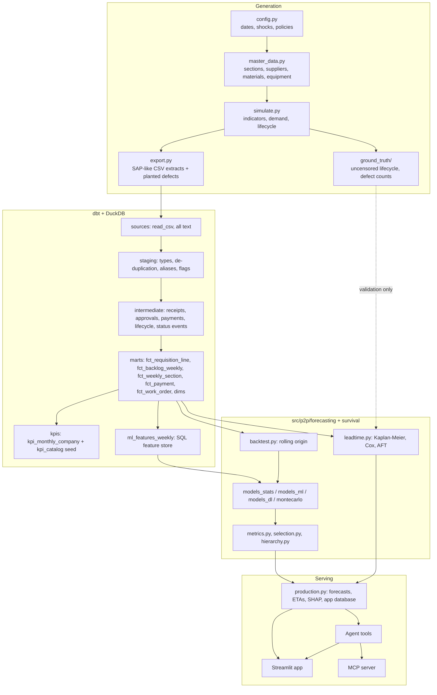

# Architecture

## Data flow

## Design decisions

| Decision | Choice | Reason |
|---|---|---|
| Engine | DuckDB | Columnar analytics in one file: runs in CI, notebooks and the app with no server |
| Transformations | dbt | Versioned SQL, tests, documentation and lineage; portable to BigQuery or Snowflake |
| Status logic | Derived from documents | The SAP status field was proven unreliable in the audit |
| Feature store | SQL window functions | One source of feature logic; leakage audited empirically |
| Forecast strategy | Direct multi-horizon for ML | No error accumulation across the 12 weeks |
| Uncertainty | Native intervals, conformal for ML, simulation quantiles for Monte Carlo | Every model is scored on calibration, not only accuracy |
| Model choice | Weighted scorecard | Makes trade-offs explicit and adjustable by stakeholders |
| Lead time | Survival analysis | Open orders are censored observations; ignoring them biases estimates |
| App data | Compact DuckDB copy + parquet artifacts | The deployed app needs no warehouse rebuild and no heavy ML stack |
| Agent | OpenAI-compatible tool calling + offline router | Provider-agnostic, free-tier friendly, never breaks in a demo |

## Layer contracts

* Raw extracts are never modified; every repair happens in dbt and leaves a `dq_` flag.
* Marts are the only schemas exposed to the app, the agent and the MCP server (`marts`, `kpis`, `reference`).
* The KPI engine used by the app is contract-tested against the dbt KPI table (`tests/test_warehouse.py`).
